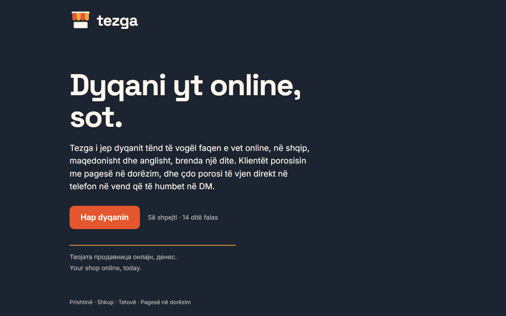

<p align="center"></p>

# Tezga

**Tezga gives a small shop its own online store in Albanian, Macedonian and English in one day. Customers order with cash on delivery, and every order arrives on the owner's phone instead of getting lost in DMs.**

## Start it (Node.js 22.13+)

```bash
npm install
npm run migrate
npm run dev
```

- Landing page: http://localhost:5173
- API health: http://localhost:3001/health → `{"status":"ok","database":"ok","tables":13}`
- Database: `backend/data/tezga.db` (open it with [DB Browser for SQLite](https://sqlitebrowser.org) or the VS Code "SQLite Viewer" extension to see the tables)



## Docs (read these before building)

| File | What's inside |
|---|---|
| [docs/business.md](docs/business.md) | Problem, big picture, market & competitors, business model & price (parts 1–4) |
| [docs/brand-book.md](docs/brand-book.md) | Name, tagline, logo, colours, fonts, tone of voice. Logo files in [docs/brand/](docs/brand/) |
| [docs/rules-and-flows.md](docs/rules-and-flows.md) | Roles, main flows, business rules, what v1 will NOT do (part 6) |
| [docs/stack.md](docs/stack.md) | Technologies and why |
| [docs/data-model.md](docs/data-model.md) | Tables, fields, links, with the diagram |
| [CLAUDE.md](CLAUDE.md) | Stack, folder layout, commands, rules for Claude Code |

Status: weekend 2 (the frame): landing page, `/health`, SQLite with the first migration. No features yet.
