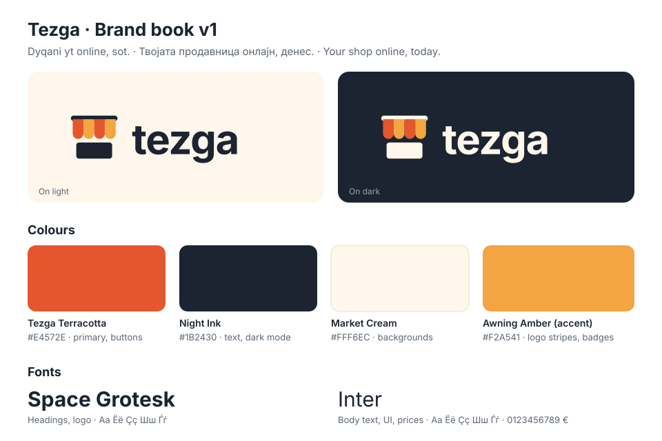

# Tezga: Brand book v1

## Name

**Tezga** (*tezgë* in Albanian, *тезга* in Macedonian) means **the market stall**: the place where a small seller shows their goods. The word is the same in both languages, short, easy to say and easy to type.

| Check | Result (13 Nov 2026) |
|---|---|
| `tezga.shop` | **Not registered** (RDAP lookup returned "not found"). **Buy it before telling anyone.** |
| `tezga.co`, `gettezga.com` | Not registered (backups) |
| `tezga.app`, `tezga.store`, `tezga.online` | Taken |
| Instagram `@tezga.shop` / `@tezgashop` | **[VERIFY manually]**: open `instagram.com/tezga.shop` while logged in. Instagram blocks automatic checks. |

## Tagline

- 🇦🇱 **Dyqani yt online, sot.**
- 🇲🇰 **Твојата продавница онлајн, денес.**
- 🇬🇧 **Your shop online, today.**

## Logo

A market stall seen from the front: a striped awning (terracotta + amber) above a counter, next to the lowercase wordmark **tezga**.

| On light | On dark |
|---|---|
|  |  |

Files in [`brand/`](brand/):
- `logo-light.svg`: full logo for light backgrounds
- `logo-dark.svg`: full logo for dark backgrounds
- `icon.svg` / `icon-dark.svg`: app icon / favicon / Instagram profile picture
- `brand-board.svg` / `brand-board.png`: the one-page brand board

**Rules:** keep clear space around the logo equal to the counter's height. Never stretch it, recolour the awning, or put the light logo on a busy photo.

> Note: the wordmark in the SVGs uses live text (Space Grotesk, falling back to Inter or Arial). Before printing anything, convert the text to outlines in Figma or Inkscape.

## Colours

| Swatch | Name | Hex | Use |
|---|---|---|---|
| 🟧 | **Tezga Terracotta** | `#E4572E` | Primary: buttons, links, the "Order" call to action |
| ⬛ | **Night Ink** | `#1B2430` | Text, dark-mode background |
| ⬜ | **Market Cream** | `#FFF6EC` | Light backgrounds, cards |
| 🟨 | Awning Amber (accent only) | `#F2A541` | Logo stripes, "New" / "Sale" badges, never body text |

Contrast: Night Ink on Market Cream passes WCAG AAA. White text on Terracotta is fine for **large/bold** button labels only; for small text on terracotta use Night Ink.

## Fonts

| Font | Use | Why |
|---|---|---|
| **Space Grotesk** (700) | Logo, headings | Friendly and a bit technical; already used in the Nkonlinestore code |
| **Inter** (400/600) | Body, UI, prices | Very readable on phones; full support for **ë, ç** and **Cyrillic** (Macedonian) |

Both are free (Google Fonts / OFL) and are self-hosted as `.woff2` files.

## Tone of voice: **Direct · Warm · Local**

- **Direct:** short sentences, numbers instead of adjectives, no tech words ("shop", not "platform"; "order", not "checkout flow").
- **Warm:** we talk like a helpful neighbour who knows tech, using the informal *ti* / *ти*.
- **Local:** Prishtinë, Shkup, Tetovë, cash on delivery, couriers: our examples come from here.

| ✅ Sounds like Tezga | ❌ Does not sound like Tezga |
|---|---|
| "Ke porosi të re: 2 bluza, 24 €, Tetovë. Thirre klientin sot." (*"You have a new order: 2 shirts, €24, Tetovë. Call the customer today."*) | "Leverage our omnichannel e-commerce solution to optimise your conversion funnel." |
