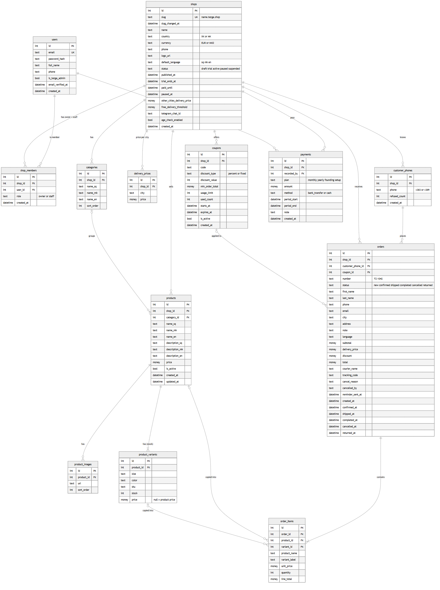

# Tezga: Data model

What Tezga stores, taken from [rules-and-flows.md](rules-and-flows.md). The tables are created by [`backend/migrations/001_init.sql`](../backend/migrations/001_init.sql), and each table has a model in [`backend/src/models/`](../backend/src/models/).



Diagram source: [data-model.mmd](data-model.mmd) (Mermaid). The same model in DBML for [dbdiagram.io](https://dbdiagram.io) is at the end of this page.

## Conventions

- **Money** is an `INTEGER` in minor units: 15.00 € is stored as `1500`. The currency comes from `shops.currency` (rule 10: no conversion).
- **Dates** are ISO 8601 text in UTC (`2026-11-17T10:00:00Z`).
- **Booleans** are `0`/`1`.
- **Customer-facing text** has one column per language: `_sq`, `_mk`, `_en`.

## The models

| Model (table) | What it is | Links | Rules it serves |
|---|---|---|---|
| **User** (`users`) | Someone who logs in: owner, staff or Tezga admin | → many ShopMembers, → many Payments recorded | Roles |
| **Shop** (`shops`) | One store at `slug.tezga.shop`, with status, trial and delivery settings | → many of almost everything | 8, 10, 11, 12, 14, 16 |
| **ShopMember** (`shop_members`) | Links a User to a Shop as `owner` (exactly one) or `staff` (max 2) | Shop ↔ User (many-to-many) | Roles |
| **Category** (`categories`) | Product group in a shop | Shop → many Categories → many Products | |
| **Product** (`products`) | Something the shop sells, base price | Shop, Category (optional) → Images, Variants | |
| **ProductImage** (`product_images`) | Photo of a product | Product → many | |
| **ProductVariant** (`product_variants`) | Size/colour option. **Stock lives here.** Every product has at least one | Product → many | 2, 3 |
| **DeliveryPrice** (`delivery_prices`) | Delivery price for one city | Shop → many | 8 |
| **Coupon** (`coupons`) | Discount code: percent or fixed, minimum, limit, dates | Shop → many, → many Orders | 9 |
| **CustomerPhone** (`customer_phones`) | A customer's phone as one shop knows it, with the refused-delivery count. Customers have no accounts in v1 | Shop → many, → many Orders | 6, 7 |
| **Order** (`orders`) | A cash-on-delivery order with frozen totals and a time stamp for each status | Shop, CustomerPhone, Coupon (optional) → many OrderItems | 1, 4, 5 |
| **OrderItem** (`order_items`) | One line of an order. Name and price are **copied**, so editing a product never changes an old order | Order, Product, Variant | 1 |
| **Payment** (`payments`) | Subscription payment recorded by hand by the Tezga admin | Shop, User (who recorded it) | 13 |

### Order statuses (flow 3)

```
new ──► confirmed ──► shipped ──► completed
 │          │            │
 └──► cancelled ◄────────┘        shipped ──► returned (stock back, refused_count + 1)
```

### What the database itself guarantees

- Shop address: 3–30 characters, `a-z 0-9 -`, unique (rule 14).
- Exactly one owner per shop (partial unique index).
- Stock can never go below 0 (rule 3).
- `orders.total = subtotal + delivery_price - discount` and can never be negative (rules 1 and 9).
- `order_items.line_total = unit_price × quantity`.
- Customer phone numbers start with `+383` or `+389` (rule 6).
- One coupon code and one delivery price per city, per shop.

Rules that depend on time or counting (72-hour auto-cancel, max 3 open orders per phone, max 2 staff, 90-day deletion) are checked by the back end in later weekends.

## DBML (paste into dbdiagram.io)

```dbml
Table users {
  id integer [pk]
  email text [unique, not null]
  password_hash text [not null]
  full_name text [not null]
  phone text
  is_tezga_admin boolean [not null, default: false]
  email_verified_at datetime
  created_at datetime [not null]
}

Table shops {
  id integer [pk]
  slug text [unique, not null, note: 'name.tezga.shop']
  slug_changed_at datetime
  name text [not null]
  country text [not null, note: 'XK | MK']
  currency text [not null, note: 'EUR | MKD']
  phone text
  logo_url text
  default_language text [not null, note: 'sq | mk | en']
  status text [not null, note: 'draft | trial | active | paused | suspended']
  published_at datetime
  trial_ends_at datetime
  paid_until datetime
  paused_at datetime
  other_cities_delivery_price integer [not null]
  free_delivery_threshold integer
  telegram_chat_id text
  age_check_enabled boolean [not null]
  created_at datetime [not null]
}

Table shop_members {
  id integer [pk]
  shop_id integer [not null, ref: > shops.id]
  user_id integer [not null, ref: > users.id]
  role text [not null, note: 'owner | staff']
  created_at datetime [not null]
  indexes { (shop_id, user_id) [unique] }
}

Table categories {
  id integer [pk]
  shop_id integer [not null, ref: > shops.id]
  name_sq text [not null]
  name_mk text
  name_en text
  sort_order integer [not null]
}

Table products {
  id integer [pk]
  shop_id integer [not null, ref: > shops.id]
  category_id integer [ref: > categories.id]
  name_sq text [not null]
  name_mk text
  name_en text
  description_sq text
  description_mk text
  description_en text
  price integer [not null]
  is_active boolean [not null]
  created_at datetime [not null]
  updated_at datetime [not null]
}

Table product_images {
  id integer [pk]
  product_id integer [not null, ref: > products.id]
  url text [not null]
  sort_order integer [not null]
}

Table product_variants {
  id integer [pk]
  product_id integer [not null, ref: > products.id]
  size text
  color text
  sku text
  stock integer [not null]
  price integer [note: 'null = product price']
}

Table delivery_prices {
  id integer [pk]
  shop_id integer [not null, ref: > shops.id]
  city text [not null]
  price integer [not null]
  indexes { (shop_id, city) [unique] }
}

Table coupons {
  id integer [pk]
  shop_id integer [not null, ref: > shops.id]
  code text [not null]
  discount_type text [not null, note: 'percent | fixed']
  discount_value integer [not null]
  min_order_total integer [not null]
  usage_limit integer
  used_count integer [not null]
  starts_at datetime
  expires_at datetime
  is_active boolean [not null]
  created_at datetime [not null]
  indexes { (shop_id, code) [unique] }
}

Table customer_phones {
  id integer [pk]
  shop_id integer [not null, ref: > shops.id]
  phone text [not null, note: '+383 | +389']
  refused_count integer [not null]
  created_at datetime [not null]
  indexes { (shop_id, phone) [unique] }
}

Table orders {
  id integer [pk]
  shop_id integer [not null, ref: > shops.id]
  customer_phone_id integer [not null, ref: > customer_phones.id]
  coupon_id integer [ref: > coupons.id]
  number text [not null, note: 'TZ-1042']
  status text [not null, note: 'new | confirmed | shipped | completed | cancelled | returned']
  first_name text [not null]
  last_name text [not null]
  phone text [not null]
  email text
  city text [not null]
  address text [not null]
  note text
  language text [not null]
  subtotal integer [not null]
  delivery_price integer [not null]
  discount integer [not null]
  total integer [not null]
  courier_name text
  tracking_code text
  cancel_reason text
  cancelled_by text
  reminder_sent_at datetime
  created_at datetime [not null]
  confirmed_at datetime
  shipped_at datetime
  completed_at datetime
  cancelled_at datetime
  returned_at datetime
  indexes { (shop_id, number) [unique] }
}

Table order_items {
  id integer [pk]
  order_id integer [not null, ref: > orders.id]
  product_id integer [ref: > products.id]
  variant_id integer [ref: > product_variants.id]
  product_name text [not null]
  variant_label text
  unit_price integer [not null]
  quantity integer [not null]
  line_total integer [not null]
}

Table payments {
  id integer [pk]
  shop_id integer [not null, ref: > shops.id]
  recorded_by integer [not null, ref: > users.id]
  plan text [not null, note: 'monthly | yearly | founding | setup']
  amount integer [not null]
  method text [not null, note: 'bank_transfer | cash']
  period_start datetime
  period_end datetime
  note text
  created_at datetime [not null]
}
```
